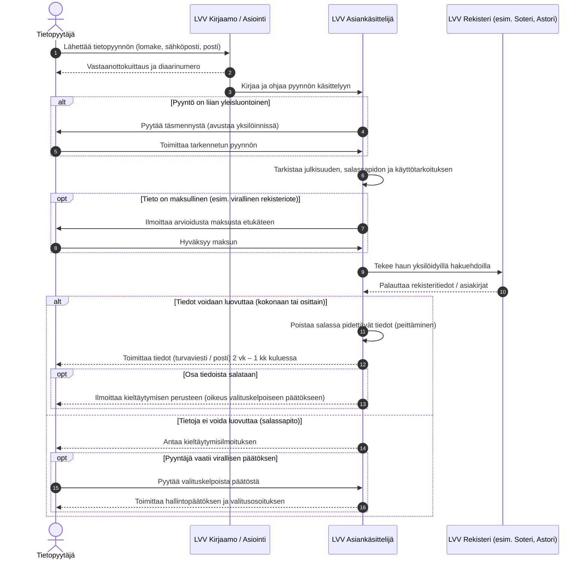
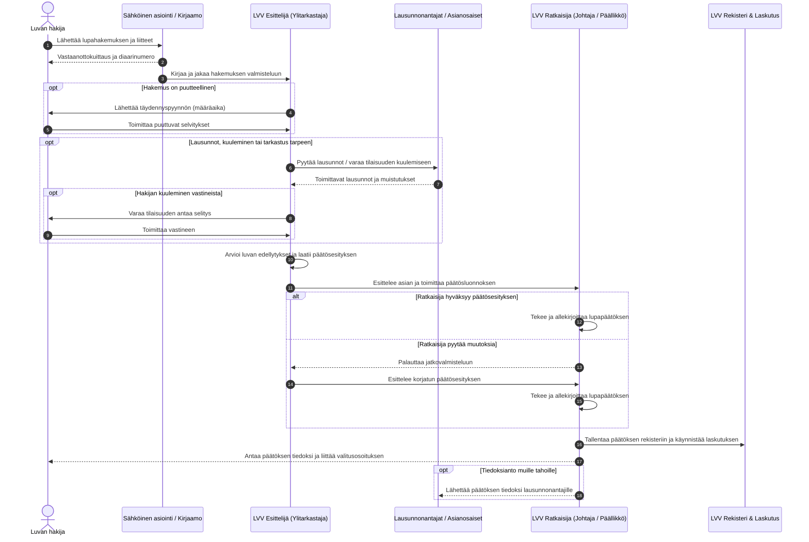

# Lupa- ja valvontaviraston (LVV) prosessikaaviot

Tämä dokumentti kuvaa Lupa- ja valvontaviraston (LVV) keskeiset asianhallintaprosessit sekvenssikaavioina. Kaaviot on toteutettu Mermaid-syntaksilla, ja ne renderöityvät suoraan GitHubin Markdown-näkymässä.

## Sisällysluettelo
1. [Rekisteriä koskeviin tietopyyntöihin vastaaminen](#1-rekisteriä-koskeviin-tietopyyntöihin-vastaaminen)
2. [Lupapäätösten valmistelu ja ratkaiseminen](#2-lupapäätösten-valmistelu-ja-ratkaiseminen)

---

## 1. Rekisteriä koskeviin tietopyyntöihin vastaaminen

Prosessi noudattaa julkisuuslain määräaikoja. Tavanomainen julkinen tieto toimitetaan kahden viikon kuluessa ja erityistoimenpiteitä vaativa laajempi pyyntö viimeistään kuukauden kuluessa.

### Keskeiset vaiheet
* **Vireilletulo ja kirjaaminen:** Pyyntö saapuu kirjaamoon tai sähköisen asioinnin kautta, kirjataan diaariin ja ohjataan käsittelijälle.
* **Yksilöinti:** Käsittelijä auttaa pyytäjää täsmentämään pyyntöä, jos haluttua asiakirjaa tai rekisteritietoa ei voida heti paikallistaa.
* **Julkisuus- ja maksullisuusharkinta:** Käsittelijä tarkistaa salassapitoperusteet ja ilmoittaa mahdollisesta maksuasetuksen mukaisesta maksusta etukäteen.
* **Luovutus tai päätös:** Tiedot toimitetaan pyytäjälle tai kieltäytymisestä annetaan pyydettäessä valituskelpoinen hallintopäätös.

---

## 2. Lupapäätösten valmistelu ja ratkaiseminen

Lupahakemusten käsittely noudattaa hallintolakia. Päätöksenteossa sovelletaan esittelymenettelyä, jossa esittelijä valmistelee päätösehdotuksen ja ratkaisija hyväksyy sen.

### Keskeiset vaiheet
* **Vireilletulo ja täydennys:** Hakemus kirjataan diaariin. Puutteelliseen hakemukseen pyydetään täydennystä määräajassa.
* **Kuuleminen ja lausunnot:** Tarvittaessa kuullaan asianosaisia ja pyydetään lausunnot muilta viranomaisilta. Hakijalle varataan tilaisuus antaa vastine.
* **Esittely ja ratkaisu:** Esittelijä laatii päätösesityksen, jonka ratkaisija tarkastaa ja allekirjoittaa.
* **Tiedoksianto ja laskutus:** Päätös valitusosoituksineen lähetetään tiedoksi, tallennetaan rekisteriin ja käynnistetään käsittelymaksun laskutus.