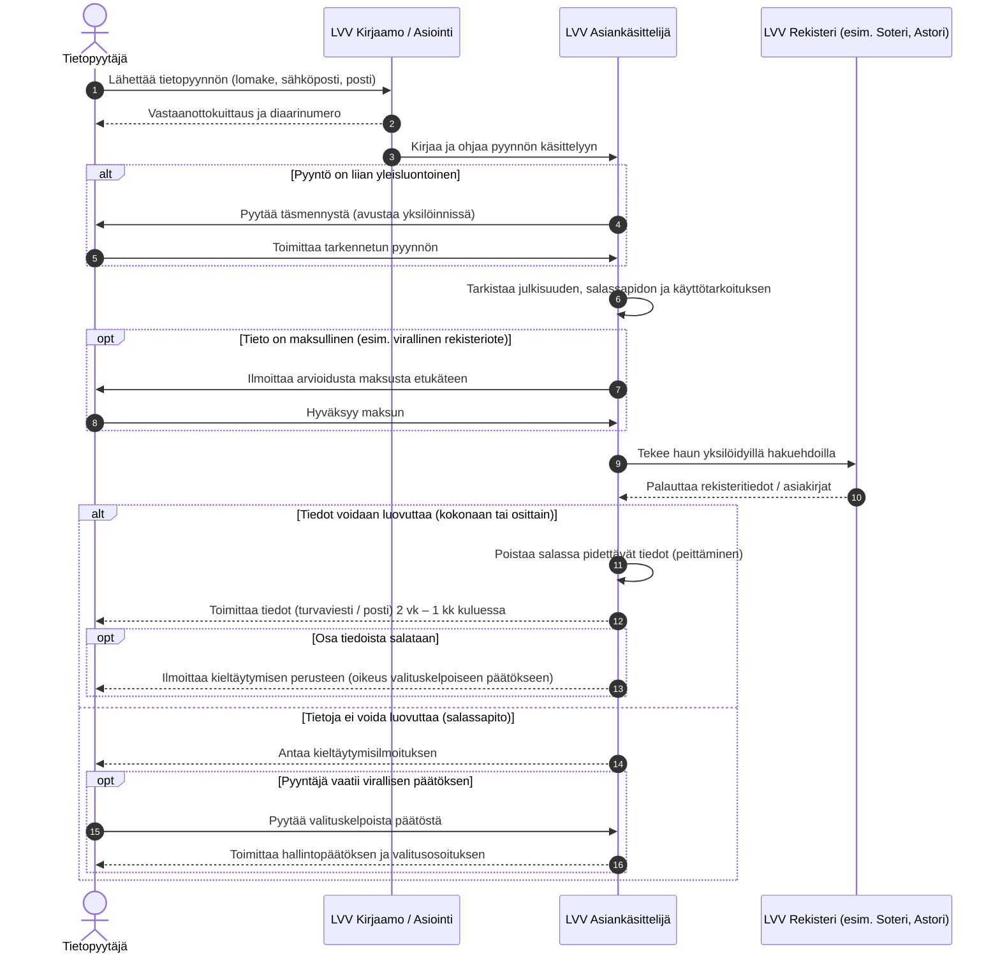

# Lupa- ja valvontaviraston (LVV) prosessikaaviot

Tämä dokumentti kuvaa Lupa- ja valvontaviraston (LVV) keskeiset asianhallintaprosessit sekvenssikaavioina. Kaaviot on toteutettu Mermaid-syntaksilla, ja ne renderöityvät suoraan GitHubin Markdown-näkymässä.

## Sisällysluettelo
1. [Rekisteriä koskeviin tietopyyntöihin vastaaminen](#1-rekisteriä-koskeviin-tietopyyntöihin-vastaaminen)
2. [Lupapäätösten valmistelu ja ratkaiseminen](#2-lupapäätösten-valmistelu-ja-ratkaiseminen)

---

## 1. Rekisteriä koskeviin tietopyyntöihin vastaaminen

Prosessi noudattaa julkisuuslain määräaikoja. Tavanomainen julkinen tieto toimitetaan kahden viikon kuluessa ja erityistoimenpiteitä vaativa laajempi pyyntö viimeistään kuukauden kuluessa.

